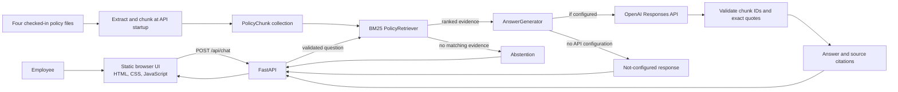

# PeopleDesk AI — HR Policy Assistant

PeopleDesk AI is a source-grounded assistant prototype that helps employees find information in HR policies. Employees ask questions in a browser. The backend searches the checked-in policy documents and, when configured, uses an LLM provider to write an answer tied to retrieved passages.

The included Acme Global Technologies policies are fictional examples for demonstration and testing. This project is not connected to a real employer and is not legal or HR advice.

## Problem

Employees may need to search lengthy policy documents to answer routine questions about leave, attendance, benefits, and conduct. A general-purpose chatbot can invent rules or give answers that are difficult to verify. PeopleDesk AI is designed to retrieve the relevant policy text and show the source for each generated claim, and to abstain when it has no evidence.

## Objectives

- Make the checked-in sample HR policies easier to query in natural language.
- Preserve document, section, and chunk provenance from ingestion through the API response.
- Use a transparent lexical retrieval baseline and source-grounded answer generation.
- Make errors and insufficient evidence clear instead of fabricating a policy answer.
- Keep the UI, API, retrieval, generation, and tests usable as separate components.

## Implemented features

- Markdown and plain-text extraction, policy metadata validation, and section-aware chunking with overlap.
- In-memory BM25 retrieval with configurable result count and optional category filtering.
- Optional OpenAI Responses API generation. The provider is not configured unless `OPENAI_API_KEY` is supplied to the backend process.
- Exact retrieved chunk IDs and quotes are checked before citations are built; unavailable source fields remain absent.
- FastAPI `GET /api/health` and `POST /api/chat`, request validation, CORS settings, abstentions, and safe error responses.
- A responsive static HTML/CSS/JavaScript chat page at `docs/index.html`. It calls the backend; it does not produce canned answers or call OpenAI directly.
- Unit, API, end-to-end, retrieval evaluation, browser interaction, and frontend configuration tests using mocked providers. Automated tests do not make paid AI calls.

## Technology stack

- Python 3.11 for the backend code and tests.
- FastAPI and Uvicorn for the HTTP API and local ASGI server.
- Python BM25 implementation for lexical retrieval.
- Official OpenAI Python SDK and Responses API for optional live generation.
- Plain HTML, CSS, and JavaScript for the frontend; no React app, npm package, or bundler is present.
- Python `unittest`, FastAPI `TestClient`/HTTPX, and Node's built-in test runner for verification.

## Architecture



The page in `docs/` is a static frontend; this repository does not contain a React application. At startup, the API processes the four checked-in policies into chunks and keeps them in memory. See [the architecture guide](docs/architecture.md) and [the question workflow](docs/project_workflow.md).

## Project structure

```text
backend/
  api/                 FastAPI routes and sample-policy loading
  docs/                Ingestion, retrieval, generation, API, and test guides
  generation/          Provider interface, prompt, grounding checks, citations
  ingestion/           Metadata validation, extraction, and chunking
  retrieval/           BM25 ranker and traceable retrieval results
  schemas/             Policy document, chunk, and source metadata models
  tests/               Backend unit, API, end-to-end, and evaluation tests
docs/
  index.html           Static responsive chat UI
  chat.js              API request and response rendering
  api-config.js        Public frontend API URL config (empty by default)
  architecture.md      System architecture
  project_workflow.md  End-to-end question flow
  setup_guide.md       Local development setup
  demo_guide.md        Mentor presentation plan
frontend/
  build_config.py      Generates the public browser API URL config
  tests/               Browser interaction and config tests
sample-policies/       Fictional leave, attendance, benefits, and conduct policies
requirements.txt       Backend and API dependencies
```

## Local installation and setup

Requirements: Python 3.11, Git, and a modern browser. Node.js 18 or newer is needed for the frontend interaction tests (Node.js 20+ is recommended). The frontend has no package installation step.

From PowerShell:

```powershell
git clone https://github.com/harini18122005/HR-Sprint-.git
Set-Location HR-Sprint-
py -3.11 -m venv .venv
.\.venv\Scripts\Activate.ps1
python -m pip install --upgrade pip
python -m pip install -r requirements.txt
```

The application reads environment variables from the process; it does not automatically load `.env` files. See [.env.example](.env.example) for placeholder names only. Never put a real OpenAI key in the frontend or commit one.

## Run the backend

In the first PowerShell terminal, activate the virtual environment and run:

```powershell
$env:FRONTEND_ORIGINS = "http://localhost:4173,http://127.0.0.1:4173"
# Optional: set OPENAI_API_KEY in this backend terminal to enable live generation.
python -m uvicorn backend.api.app:app --reload --host 127.0.0.1 --port 8000
```

Check service health at `http://127.0.0.1:8000/api/health`. A healthy API can report `"generation_configured": false` when no key is present. In that case matching chat requests return HTTP 503 with a not-configured message; the API does not return a mock answer.

## Run the frontend

In a second PowerShell terminal, activate the virtual environment and configure the public backend URL before starting the static page:

```powershell
$env:PEOPLEDESK_API_BASE_URL = "http://127.0.0.1:8000"
python frontend/build_config.py
python -m http.server 4173 --directory docs
```

Open `http://127.0.0.1:4173`. `PEOPLEDESK_API_BASE_URL` is public browser configuration, not a secret. The generated `docs/api-config.js` must never contain an API key. Detailed troubleshooting is in the [local setup guide](docs/setup_guide.md).

## Run the tests

Run from the repository root:

```powershell
python -m unittest discover -s backend/tests -v
node --test frontend/tests/chat.test.cjs
python -m unittest frontend.tests.test_build_config -v
```

The Day 10 verification run completed with 87 backend tests, 7 frontend interaction tests, and 5 frontend configuration tests passing. The backend suite uses mocked providers; this verifies application behavior without proving live model behavior or making OpenAI API calls. See [testing and evaluation](backend/docs/testing_evaluation.md) for coverage and limitations.

## Example employee questions

- How many unused PTO days can carry over?
- When are core collaboration hours?
- What HSA contribution is available for families?
- Where can I report a suspected code-of-conduct violation?

The policy content comes from `sample-policies/`, not a live company policy database.

## API example

The request body accepted by the implemented chat endpoint is:

```http
POST /api/chat
Content-Type: application/json

{"question":"What are annual PTO accrual rates?"}
```

Without `OPENAI_API_KEY`, the actual implementation returns HTTP 503 and a not-configured response rather than inventing an answer:

```json
{
  "answer": "Live answer generation is not configured. Set OPENAI_API_KEY and install the OpenAI SDK to enable it; no live answer was generated.",
  "citations": [],
  "abstained": true,
  "status": "not_configured",
  "error": "live_generation_not_configured"
}
```

When generation is configured and succeeds, the same response shape contains an answer plus citation objects with the source document, document ID, section when available, chunk ID, exact quote, and page number only when available. The exact generated wording depends on the provider response. See [the API guide](backend/docs/api.md).

## Completed milestones

Days 1–9 delivered project setup, schemas and validation, sample policy extraction, text chunking, BM25 retrieval, grounded answer generation, the static UI mockup, frontend/backend API integration, and testing/evaluation. Day 10 completes final project documentation and demo preparation.

## Current limitations

- The policies are fictional demonstration files. The backend loads these four files at startup; there is no employee policy upload workflow, persistent database, or policy administration interface.
- BM25 is lexical retrieval, not semantic search. It can miss relevant passages when the question uses different words.
- Live answer generation needs an OpenAI key and a model available to that account. No key is included. Mocked tests do not verify live generation.
- Quote and numeric validation helps source traceability but cannot prove every natural-language paraphrase is logically entailed by its quote.
- The API is not deployed by this repository. The page is static, but a public UI URL does not imply that a public backend exists.
- This prototype has no authentication, employee-specific authorization, production logging/monitoring, or organization-specific policy review.

## Future improvements

- Evaluate dense or hybrid retrieval on a larger, reviewed HR policy set.
- Add controlled policy ingestion, version management, and persistent storage.
- Expand reviewed answer-quality and conflict-resolution evaluations.
- Add authentication, access controls, deployment configuration, monitoring, and operational safeguards before real employee use.
- Consider a framework-based frontend only if the product requirements justify it.

## Documentation

- [Architecture](docs/architecture.md)
- [Project workflow](docs/project_workflow.md)
- [Local setup](docs/setup_guide.md)
- [Mentor demo plan](docs/demo_guide.md)
- [Backend overview and technical docs](backend/README.md)
- [Static frontend setup](frontend/README.md)
