# PeopleDesk AI Architecture

This diagram reflects the implementation in this repository. The user interface is a static HTML/CSS/JavaScript page; there is no React frontend. Policy chunks are prepared in memory from the four checked-in sample files when the API starts.

```mermaid
flowchart LR
    EMP[Employee] --> UI[Browser chat<br/>docs/index.html + chat.js]
    POL[Checked-in fictional HR policies] --> EXT[Existing extraction pipeline]
    EXT --> CHUNK[Section-aware chunker]
    CHUNK --> STORE[In-memory PolicyChunk collection]
    UI -->|JSON question<br/>POST /api/chat| API[FastAPI]
    API --> VALID[ChatRequest validation<br/>1–2000 characters]
    VALID --> RET[PolicyRetriever<br/>BM25 lexical ranker]
    STORE --> RET
    RET -->|RetrievedPolicyChunk results| GEN[AnswerGenerator]
    GEN --> CONFIG{Provider configured?}
    CONFIG -->|Yes| PROVIDER[OpenAI Responses API provider]
    PROVIDER --> VERIFY[Validate provider response]
    VERIFY --> SUFFICIENT{Evidence sufficient?}
    SUFFICIENT -->|Yes| CHECK[Validate chunk IDs, exact quotes,<br/>numeric facts, and units]
    SUFFICIENT -->|No| ABSTAIN[Insufficient-evidence abstention]
    CHECK --> RESULT[AnswerGenerationResult<br/>with locally built citations]
    CONFIG -->|No| UNCONFIGURED[Not-configured result]
    RET -->|No matching chunks| ABSTAIN
    RESULT --> APIRESPONSE[JSON API response]
    UNCONFIGURED --> APIRESPONSE
    ABSTAIN --> APIRESPONSE
    APIRESPONSE --> UI
    UI --> EMP
```

## Components

- **Static browser UI:** `docs/index.html` provides the chat layout. `docs/chat.js` sends requests to the configured backend URL and renders returned answers, citations, abstentions, and errors. `docs/api-config.js` contains a public URL and is empty by default.
- **Sample policy loader:** `backend/api/service.py` reads the leave, attendance, benefits, and code-of-conduct policy files. It reuses the existing document metadata validator, extractor, and chunker during API initialization. The chunks are held in process memory.
- **FastAPI:** `backend/api/app.py` exposes `GET /api/health` and `POST /api/chat`, validates input, applies configured CORS rules, and maps provider and internal errors to safe responses.
- **BM25 retrieval:** `backend/retrieval/retriever.py` ranks supplied chunks using lexical term matches. It preserves source metadata and does not call itself semantic search.
- **Answer generation:** `backend/generation/answer_generator.py` supplies retrieved evidence to a configured text-generation provider. The optional OpenAI adapter uses the Responses API. Returned claims must cite a retrieved chunk and exact quote; citations are built from the original metadata.
- **Abstention and errors:** no matching evidence leads to a clear abstention. Missing API configuration returns a not-configured response. Provider failures and malformed responses do not expose provider details as an answer.

## Runtime notes

`GET /api/health` reports API availability and whether a generation provider is configured. `generation_configured: false` does not prevent BM25 retrieval, but matching chat requests cannot receive a live generated answer and return HTTP 503. The API is not deployed by this project.
